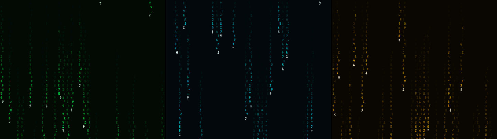

# Matrix rice for Kubuntu

A Matrix look for KDE Plasma 6 on Kubuntu 26.04: live code rain on the desktop,
lock screen and login screen, a hacker terminal, and an optional **Matrix 95**
layer (Windows 95 window frames, buttons and taskbar, recolored Matrix style).
Three colors: **green**, **cyan** and **amber**. Switch any time with one command.



## Install

You need: Kubuntu 26.04 with the normal KDE Plasma desktop, an internet
connection, and your password (for installing packages and the login screen).

1. **Open a terminal**: press the Meta (Windows) key, type `Konsole`, press Enter.
2. **Download this project.** Copy and paste these lines into Konsole, pressing Enter after each:

   ```bash
   sudo apt install -y git
   git clone https://github.com/randomperson-2343/custom-kubuntu-rice.git
   cd custom-kubuntu-rice
   ```

   If the repository is private, Git asks for your GitHub username and a
   personal access token instead of a password. Easier alternative: on the
   GitHub page click **Code > Download ZIP**, extract it in your Downloads
   folder, then in Konsole run `cd ~/Downloads/custom-kubuntu-rice-main`
   (the folder name depends on the branch you downloaded).

3. **Run the installer**, choosing your color:

   ```bash
   ./install.sh green
   ```

   (or `./install.sh cyan`, or `./install.sh amber`)

   It will:
   - ask for your password to install packages from Ubuntu's own repositories
     (fonts, cmatrix, fastfetch, starship, Kvantum),
   - back up your current settings,
   - ask whether to replace your bottom panel with the Windows 95 taskbar
     (your old layout is saved),
   - ask whether to install the Matrix login screen (needs your password).

4. **Log out and back in** once. Done.

### Installer options

| Option | What it does |
|---|---|
| `--plain` | Matrix colors only, keep normal KDE shapes (no Windows 95 look) |
| `--no-taskbar` | Keep your current panels |
| `--no-login` | Don't touch the login screen |
| `--yes` | Don't ask questions, say yes to everything |

## Everyday use

```bash
matrix-rice cyan            # switch everything to cyan (or green, amber)
matrix-rice rain off        # stop the live rain (shows a still frame); "on" to restart
matrix-rice style plain     # normal KDE shapes; "style 95" for the Windows 95 look
matrix-rice taskbar off     # put your old panels back; "taskbar on" for the Windows 95 taskbar
matrix-rice status          # what's active right now
rain                        # Matrix rain inside the terminal (press q to quit)
```

Rain speed, density, character size, frame rate and glow are in
**right-click desktop > Configure Desktop and Wallpaper**.

## Preview the login screen safely

Before logging out, you can test the login screen in a window:

```bash
sddm-greeter-qt6 --test-mode --theme /usr/share/sddm/themes/matrix-rice
```

## Uninstall

```bash
~/.local/share/matrix-rice/app/uninstall.sh
```

This puts back your previous colors, fonts, wallpaper, panels, lock screen,
login screen and terminal prompt. Backups stay in
`~/.local/share/matrix-rice/backups/`. Installed packages are left in place.

## If something looks wrong

- **Desktop stays black or plain:** run `matrix-rice green` again from Konsole
  inside your desktop session.
- **Login screen didn't change:** check that `/etc/sddm.conf` has no
  `Current=` line under `[Theme]`; that file overrides themes.
- **Widgets still look like normal KDE:** make sure `qt6-style-kvantum` is
  installed, then run `matrix-rice style 95` and restart the app.
- **Battery:** the rain runs all the time, including during games (by
  design). Use `matrix-rice rain off` when you need the battery.

## For developers

- `tests/run-tests.sh` runs lint, template, contrast, QML render and a full
  install/switch/uninstall cycle in a throwaway home folder.
- Colors live in `palettes/*.sh`; every config is a template in `templates/`
  with `{{PLACEHOLDERS}}` filled by `lib/common.sh`.
- Design spec: `docs/superpowers/specs/2026-10-20-matrix-rice-design.md`.
